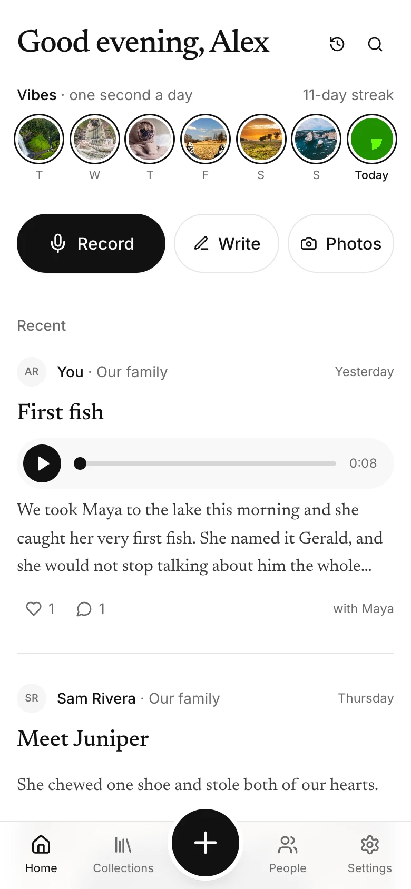
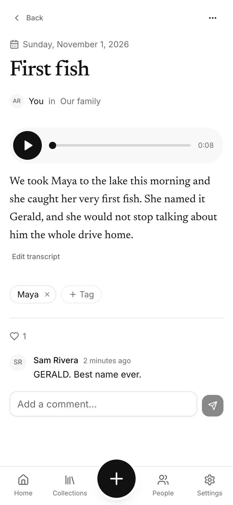
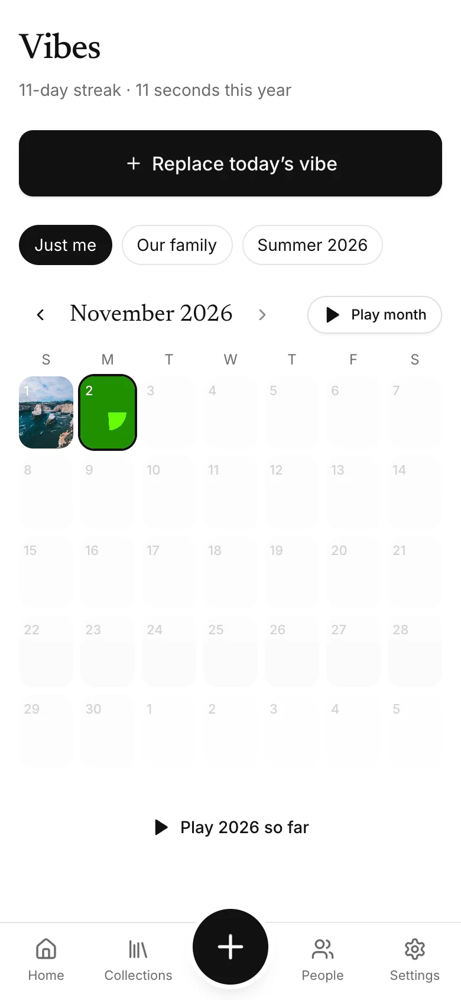
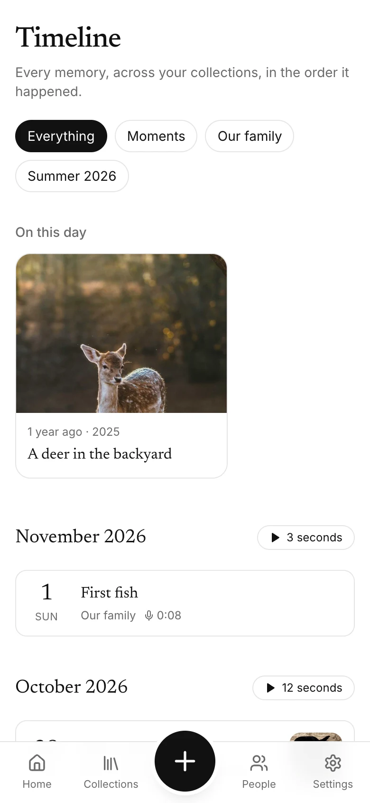

# Lore

A private place for a family's memories. Tap to record and Lore writes down what you said.
You can also write, or add photos. Share a collection with the people you love and everyone adds to it.

- **Capture in one tap.** Voice notes are saved the moment you stop, then transcribed.
- **Private by default.** Everything lands in _Moments_, which only you can see. Photos and recordings are
  never public links; every file is served only after an access check.
- **Share by collection.** Invite someone with a link. They can add memories or just view.
- **People.** Tag who's in a memory, then see all of theirs in one place.
- **Works with your AI assistant.** Lore is an MCP server: connect ChatGPT, Ri or Claude to search and add
  memories (OAuth sign-in with a consent screen; no deletes).
- **Backed up.** Nightly database dumps to a locked private bucket, D1 point-in-time restore, and a 30-day
  trash for deleted photos and recordings.
- **Your server.** One command deploys it to your own Cloudflare account (free tier friendly).

| Home                                    | A voice memory                                          | Vibes (a few seconds a day)                 | Timeline                                        |
| --------------------------------------- | ------------------------------------------------------- | ------------------------------------------- | ----------------------------------------------- |
|  |  |  |  |

Screenshots use a fictional demo family and sample photos.

## Deploy your own (Cloudflare)

You need Node 22+, pnpm (`corepack enable`), and a Cloudflare account with R2 enabled.
R2 has a free tier, but Cloudflare asks for a payment method before you can turn it on.

```bash
git clone https://github.com/dynamismlabs/lore.git
cd lore
pnpm install
pnpm deploy:cloudflare
```

That's it. The script logs you into Cloudflare, creates a D1 database and a **private** R2 bucket, runs
migrations, builds, deploys, and prints your URL. Open it and create the first account. After that, sign-up
is invite-only: make a collection and tap **Invite**.

Have several Cloudflare accounts? Put an account-scoped `CLOUDFLARE_API_TOKEN` and `CLOUDFLARE_ACCOUNT_ID` in
`.env.cloudflare` and the deploy stays in that account. Optional extras go there too (copy
`.env.cloudflare.example`): a Groq key for faster
transcription, Resend for emailing invites, Google sign-in, a custom domain. Run the same command again to
apply them, or to update after `git pull`. See [docs/deploy-cloudflare.md](docs/deploy-cloudflare.md).

## Run it locally

```bash
pnpm install
pnpm db:migrate:local   # creates a local D1 database under .wrangler/
pnpm dev                # http://localhost:3000
```

Local dev uses Miniflare's D1 and R2, so uploads work without any accounts. Add `GROQ_API_KEY` to
`.env.local` to get transcripts locally (see `.env.example`).

## Stack

- Next.js 16 (pages router) on Cloudflare Workers via [OpenNext](https://opennext.js.org/cloudflare); it
  also runs on plain Node.
- tRPC v11 for all data access, with access rules in `src/server/trpc/authz.ts`.
- Drizzle ORM. **D1 (SQLite) by default, Postgres when you want it**: one set of query code, two schemas
  kept in lockstep by `src/db/parity.test.ts`. The test suite runs against both.
- better-auth (email/password, optional Google), Tailwind + shadcn/ui, tiptap for writing.
- Media lives in R2 (binding) or any S3-compatible bucket. Transcription uses Groq Whisper or Workers AI.

### Using Postgres instead of D1

Set `DATABASE_PROVIDER=postgres` at build time. Then:

- **On Workers:** add a `HYPERDRIVE` binding pointing at your Postgres.
- **On Node** (`pnpm build && pnpm start`): set `DATABASE_URL`, plus `S3_*` for media storage.

Apply the schema with `DATABASE_URL=… pnpm db:migrate:pg`.

## Scripts

| Command                  | What it does                                                                 |
| ------------------------ | ---------------------------------------------------------------------------- |
| `pnpm dev`               | Local dev server with local D1 + R2                                          |
| `pnpm test`              | Router + schema tests on D1 (Miniflare) and Postgres (PGLite)                |
| `pnpm ts` / `pnpm lint`  | Type check / lint                                                            |
| `pnpm db:generate`       | Generate SQLite + Postgres migrations after a schema change                  |
| `pnpm preview`           | Build for Workers and run it locally in workerd                              |
| `pnpm deploy:cloudflare` | Provision + deploy to your Cloudflare account (`--dry-run` to validate only) |

## License

MIT. See [LICENSE](LICENSE).

For vulnerabilities, see [SECURITY.md](SECURITY.md). Before opening a pull request, run
`pnpm ts`, `pnpm lint` and `pnpm test`. Contributor conventions are in [AGENTS.md](AGENTS.md).
